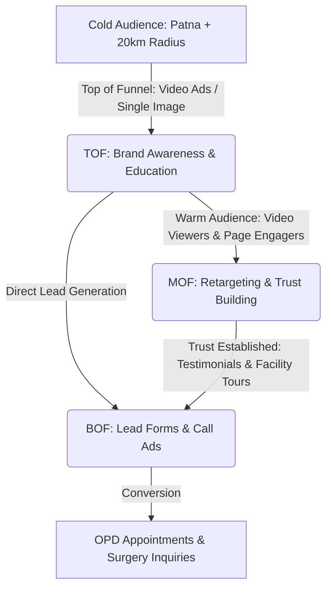
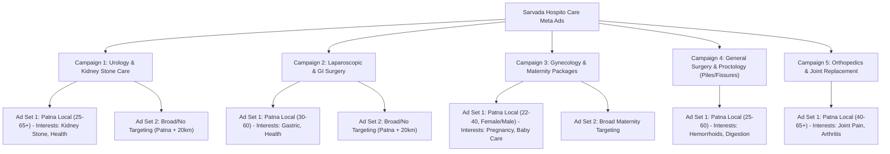

# Meta Ads (Facebook & Instagram) Campaign Mega Plan - Sarvada Hospito Care

This plan outlines the strategic roadmap for launching and scaling high-converting Facebook and Instagram Ads for **Sarvada Hospito Care** (Patna). Unlike Google Ads which captures active search intent, Meta Ads are visual and disruptive. They are highly effective for driving brand awareness, promoting specialized surgical packages (Maternity, Laser Stone, Piles), and capturing high-intent leads via instant forms, WhatsApp chats, and direct calls.

---

## 🎯 Phase 1: Meta Ads Strategy & Funnel Setup

Healthcare acquisition on Meta requires a multi-stage funnel to build trust, overcome skepticism, and drive action.

### 1. The Three-Tier Funnel
1.  **Top of Funnel (TOF) - Awareness & Education (30% Budget)**
    *   **Objective**: Video Views, Post Engagement, or Traffic.
    *   **Focus**: Educate on medical symptoms (e.g., "Signs of Gallbladder Stones") or showcase advanced technology (e.g., "100% Blade-free Laser URS/PCNL").
    *   **Creative**: Brief video reels of doctors explaining conditions, or high-quality graphics showing state-of-the-art facilities.
2.  **Middle of Funnel (MOF) - Trust & Consideration (20% Budget)**
    *   **Objective**: Lead Generation (Instant Forms) or Messages (WhatsApp/Messenger).
    *   **Focus**: Patient success stories, testimonials, and detailed treatment USPs.
    *   **Audience**: Retargeting users who watched >50% of TOF videos or engaged with the Instagram/Facebook page in the last 60 days.
3.  **Bottom of Funnel (BOF) - Direct Conversion (50% Budget)**
    *   **Objective**: Lead Generation (Meta Instant Forms), Call Ads, or Conversions (Website Appointment Bookings).
    *   **Focus**: Irresistible offers, package pricing (e.g., "Safe Delivery Packages"), and immediate call-to-actions ("Consult Patna's Leading Surgeon Today").
    *   **Audience**: Retargeting website visitors, page engagers, and lookalikes of past leads + broad local targeting.

---

## 🏗️ Phase 2: Campaign Architecture

To ensure clean budgeting and performance tracking, we divide the ad accounts into 5 primary Meta Campaigns:

---

## 📂 Phase 3: Detailed Campaign Setup & Copywriting

This section contains targeting setups, creative briefs, and high-converting ad copy (optimized in Hinglish/English for maximum local resonance in Patna and Bihar).

---

### 🫘 Campaign 1: Urology & Laser Kidney Stone Care
*   **Campaign Objective**: Lead Generation (Instant Forms for phone numbers and locations).
*   **Geo-Targeting**: Patna + 20 km radius (Kankarbagh, Bypass Road, Anisabad, Danapur, Bailey Road, etc.).
*   **Demographic Focus**: Males and Females, Age 25–65+.
*   **Detailed Targeting (Interests)**: Kidney stone, Nephrology, Urology, Health & wellness, or Broad targeting with high-intent ad copy.
*   **Offer/Hook**: Relief from sudden flank pain. 100% Blade-free Laser Stone Surgery (RIRS/PCNL) starting with quick recovery and discharge in 24 hours.

#### Creative Visual Ideas:
1.  **Image/Graphic**: High-quality photo of Dr. Manmohan Suman or a urologist next to a modern laser stone removal machine. Bold text overlay: *"बिना चीरा, बिना टांका - लेजर द्वारा गुर्दे की पथरी का सफल इलाज"* (No incision, no stitches - successful treatment of kidney stones by laser).
2.  **Video**: 45-second reel explaining the difference between traditional stone surgery (open) and advanced Laser Lithotripsy/RIRS.

#### Ad Copy Variations:
##### Ad Copy 1: Problem-Solution Focused (Hinglish/Hindi)
*   **Primary Text**:
    क्या आप गुर्दे की पथरी (Kidney Stone) के असहनीय दर्द से परेशान हैं? दवाइयां खाने के बाद भी बार-बार दर्द लौट आता है?
    
    अब और दर्द सहने की जरूरत नहीं! Sarvada Hospito Care (कंकड़बाग, पटना) में पाइए पथरी का आधुनिक और सुरक्षित इलाज।
    
    ✅ **100% ब्लेड-मुक्त लेजर सर्जरी (RIRS/PCNL)**
    ✅ **बिना चीरा, बिना टांका और दर्द-रहित इलाज**
    ✅ **मात्र 24 घंटे में अस्पताल से छुट्टी (Same Day Discharge)**
    ✅ **वरिष्ठ यूरोलॉजिस्ट द्वारा उपचार**
    
    देर न करें, आज ही परामर्श के लिए फॉर्म भरें या कॉल करें।
*   **Headline**: 🏥 पटना में लेजर द्वारा पथरी का इलाज | 24 घंटे में छुट्टी
*   **Description**: ₹500/- OPD Consultation Slot Book करें
*   **Call to Action**: Book Now (अभी बुक करें)

##### Ad Copy 2: Tech-driven & Trust (English)
*   **Primary Text**:
    Suffering from severe flank pain? Don't ignore the warning signs of Kidney Stones.
    
    Get advanced, blade-free laser stone removal at Sarvada Hospito Care, Patna. Our state-of-the-art Holmium Laser technology ensures complete stone clearance with no stitches, minimal discomfort, and faster recovery.
    
    Why Choose Sarvada Hospito Care?
    👉 Led by senior Urologists & MD Physicians
    👉 Ultra-modern Modular OT & ICU support
    👉 Quick discharge in 24–48 hours
    👉 Cashless TPA & Insurance Options Available
    
    Click below to check pricing & book your appointment.
*   **Headline**: Advanced Laser Stone Surgery in Patna (Stitch-free)
*   **Description**: Get Relief from Kidney Stone Pain Today!
*   **Call to Action**: Learn More

---

### 🤰 Campaign 2: Gynecology & Maternity Care (Normal Delivery Focus)
*   **Campaign Objective**: Lead Generation (Instant Forms / WhatsApp Messages).
*   **Geo-Targeting**: Patna + 15 km radius.
*   **Demographic Focus**: Females and Males (Expectant Parents/Spouses), Age 20–40.
*   **Detailed Targeting (Interests)**: Pregnancy, Newborn baby, Baby shower, Diaper, Parenting, Motherhood, Infant care.
*   **Offer/Hook**: Safe & Affordable Normal Delivery Packages with 24/7 Neonatal and ICU support.

#### Creative Visual Ideas:
1.  **Image/Graphic**: Warm, emotional image of a mother holding her newborn baby with a female doctor smiling in the background. Soft pink/gold theme. Text overlay: *"सुरक्षित प्रसव, स्वस्थ शिशु - सर्वदा हॉस्पिटल केयर"* (Safe delivery, healthy baby - Sarvada Hospito Care).
2.  **Carousel**:
    *   *Slide 1*: Safe Delivery Suites (Image of clean private AC rooms).
    *   *Slide 2*: 24/7 Maternity Emergency (Equipped OT).
    *   *Slide 3*: Newborn Care & ICU/NICU support.
    *   *Slide 4*: Expert Gynecologists team.

#### Ad Copy Variations:
##### Ad Copy 1: Emotional & Safety Angle (Hinglish)
*   **Primary Text**:
    मां बनना हर महिला के जीवन का सबसे खूबसूरत अहसास है। इस सफर को सुरक्षित और सुखद बनाइए Sarvada Hospito Care के साथ।
    
    पटना के बाईपास रोड, कंकड़बाग में स्थित सर्वदा हॉस्पिटल लाया है गर्भवती महिलाओं के लिए बेहतरीन और किफायती डिलीवरी पैकेज।
    
    🌸 **नॉर्मल डिलीवरी (Normal Delivery) को प्राथमिकता**
    🌸 **24x7 अनुभवी महिला स्त्री रोग विशेषज्ञ (Gynecologists)**
    🌸 **नवजात शिशु के लिए एडवांस NICU/ICU बैकअप**
    🌸 **साफ-सुथरे AC रूम्स और कुशल नर्सिंग स्टाफ**
    
    अपने बच्चे के स्वागत के लिए सबसे सुरक्षित अस्पताल चुनें। आज ही कंसल्टेशन बुक करें।
*   **Headline**: 🤰 पटना में सुरक्षित नॉर्मल डिलीवरी पैकेज
*   **Description**: 24/7 इमरजेंसी प्रसूति सहायता उपलब्ध
*   **Call to Action**: Send Message (WhatsApp)

##### Ad Copy 2: Package & Facility Focus (English)
*   **Primary Text**:
    Plan a safe, comfortable, and memorable birth experience for your little one at Sarvada Hospito Care, Patna.
    
    From comprehensive antenatal check-ups to post-delivery care, our expert obstetrics team is here for you 24/7.
    
    Our Maternity Features:
    ✨ Experienced Female Gynecologists & Pediatricians
    ✨ High-end Labor Rooms & Advanced OT Setup
    ✨ Emergency C-Section facility & Critical Care backup
    ✨ Clean, hygienic private AC Rooms for your family
    
    Schedule a tour of our maternity wing today. Fill out the form below.
*   **Headline**: Comprehensive Safe Delivery Packages in Patna
*   **Description**: Book your OPD consultation with our expert Gynecologists
*   **Call to Action**: Learn More

---

### 🔬 Campaign 3: Laparoscopic Surgery (Gallbladder, Hernia, Appendix)
*   **Campaign Objective**: Lead Generation (Instant Forms / Direct Calls).
*   **Geo-Targeting**: Patna + 25 km radius.
*   **Demographic Focus**: Adults, Age 25–60.
*   **Detailed Targeting (Interests)**: Gallstone, Abdominal pain, Hernia, Laparoscopic surgery, Gastrointestinal tract, General health.
*   **Offer/Hook**: Minimally invasive keyhole surgery with tiny incisions, minimal scarring, and quick recovery.

#### Creative Visual Ideas:
1.  **Image/Graphic**: Split screen. Left side: An icon showing a large incision (Traditional surgery). Right side: 3 tiny dots (Laparoscopy). Text overlay: *"दूरबीन द्वारा ऑपरेशन (Laparoscopy) - छोटा कट, जल्दी रिकवरी"* (Keyhole surgery - small cut, quick recovery).
2.  **Video**: Animated or whiteboard video showing how laparoscopic cholecystectomy (gallbladder removal) is performed safely and why it prevents future emergency blockages.

#### Ad Copy Variations:
##### Ad Copy 1: Gallstones focus (Hinglish/Hindi)
*   **Primary Text**:
    क्या आपको पेट के दाहिने हिस्से में तेज दर्द होता है? या गैस और अपच की समस्या से परेशान हैं? यह पित्त की थैली की पथरी (Gallbladder Stone) के लक्षण हो सकते हैं।
    
    पित्त की पथरी का एकमात्र सुरक्षित इलाज है सर्जरी। Sarvada Hospito Care (पटना) में पाइए आधुनिक दूरबीन विधि (Laparoscopic Surgery) द्वारा इलाज।
    
    ✅ **दूरबीन द्वारा छोटा चीरा (Keyhole Surgery)**
    ✅ **न्यूनतम दर्द और कोई बड़ा दाग नहीं**
    ✅ **24 से 48 घंटे में अस्पताल से छुट्टी**
    ✅ **अनुभवी लैप्रोस्कोपिक सर्जन्स की टीम**
    
    बिना देरी किए आज ही हमारे सर्जन्स से परामर्श लें। फॉर्म भरें।
*   **Headline**: 🔬 पित्ताशय की पथरी (Gallstone) का दूरबीन द्वारा ऑपरेशन
*   **Description**: कंकड़बाग बाईपास, पटना | TPA कैशलेस उपलब्ध
*   **Call to Action**: Book Now

##### Ad Copy 2: Hernia & Appendix focus (English)
*   **Primary Text**:
    Diagnosed with a Hernia or Appendicitis? Don't delay the treatment. Delays can lead to emergency complications.
    
    Sarvada Hospito Care provides advanced Minimally Invasive Laparoscopic Surgery for Hernia and Appendix in Patna.
    
    Why choose Laparoscopy at Sarvada?
    🔹 Smaller incisions mean faster healing & less pain
    🔹 Minimal blood loss and cosmetically superior (no big scars)
    🔹 Return to work in just a few days
    🔹 Led by highly skilled gastrointestinal surgeons
    
    Book an appointment today to discuss your treatment options.
*   **Headline**: Laparoscopic Hernia & Appendix Surgery | Patna
*   **Description**: Modern Modular OT & Experienced Surgeons
*   **Call to Action**: Learn More

---

### ✂️ Campaign 4: General Surgery & Proctology (Laser Piles & Fistula)
*   **Campaign Objective**: Lead Generation (Instant Forms / Direct Calls).
*   **Geo-Targeting**: Patna + 30 km radius.
*   **Demographic Focus**: Genders (All), Age 25–60.
*   **Detailed Targeting (Interests)**: Hemorrhoids (Piles), Anal fissure, Constipation, Digestive health, Laser surgery, Pain relief.
*   **Offer/Hook**: 100% painless laser surgery for Piles, Fissures, and Fistula. No painful dressings, daycare procedure.

#### Creative Visual Ideas:
1.  **Graphic**: Abstract, non-graphic medical illustration indicating pain relief in the lower back/sitting area. Text overlay: *"बवासीर (Piles/Fissure) से हमेशा के लिए छुटकारा - एडवांस लेजर तकनीक"* (Get rid of piles forever - advanced laser technology).
2.  **Video**: A reassuring interview style video with a general surgeon explaining how laser proctology avoids the painful recovery of open piles surgery.

#### Ad Copy Variations:
##### Ad Copy 1: Empathy & Quick Recovery (Hinglish/Hindi)
*   **Primary Text**:
    बवासीर (Piles), भगंदर (Fistula) या फिशर (Fissure) का दर्द आपकी रोज़मर्रा की ज़िंदगी को मुश्किल बना रहा है? लोक-लाज के कारण दर्द मत सहिए।
    
    Sarvada Hospito Care (पटना) में पाइए दर्द-रहित एडवांस लेजर ट्रीटमेंट। अब पुरानी दर्देनाक सर्जरी की जगह चुनें आधुनिक लेजर तकनीक।
    
    ✅ **पूरी तरह से दर्द-रहित लेजर ऑपरेशन (Painless Laser Surgery)**
    ✅ **कोई चीरा नहीं, कोई टांका नहीं, कोई खून नहीं**
    ✅ **रोजाना ड्रेसिंग के दर्द से मुक्ति**
    ✅ **उसी दिन डिस्चार्ज और जल्द रिकवरी**
    
    गोपनीय और सुरक्षित परामर्श के लिए आज ही अपनी जानकारी सबमिट करें।
*   **Headline**: 🏥 बवासीर, फिशर और भगंदर का आधुनिक लेजर इलाज
*   **Description**: बिना चीर-फाड़ सफल सर्जरी | Call: 7079001600
*   **Call to Action**: Get Offer

##### Ad Copy 2: Direct Clinical Pitch (English)
*   **Primary Text**:
    Get permanent relief from Piles, Fissure, and Fistula with advanced Laser Proctology at Sarvada Hospito Care, Patna.
    
    Traditional open surgeries are painful and require weeks of recovery. Our modern laser treatment ensures you return to normal life in just 24–48 hours.
    
    Medical Advantages:
    📍 Highly targeted laser fiber technique
    📍 Safe, bloodless, and painless daycare procedure
    📍 Zero risk of recurrence with experienced general surgeons
    📍 Fully private consultations and premium post-op wards
    
    Take the first step towards a pain-free life. Schedule your consultation.
*   **Headline**: 100% Painless Laser Piles & Fistula Surgery
*   **Description**: Patna's Leading Multi-specialty Care Centre
*   **Call to Action**: Book Now

---

### 🦴 Campaign 5: Orthopedics & Joint Replacement
*   **Campaign Objective**: Lead Generation (Instant Forms targeting family decision-makers - e.g., adult children of elderly patients).
*   **Geo-Targeting**: Patna + 40 km radius.
*   **Demographic Focus**: Age 35–65+ (Targeting individuals looking for knee replacement for parents, or older adults suffering from arthritis).
*   **Detailed Targeting (Interests)**: Joint replacement, Knee replacement, Arthritis, Knee pain, Osteoarthritis, Spine, Back pain, Physiotherapy.
*   **Offer/Hook**: Total Knee/Hip Replacement with advanced physiotherapy and post-op care. Get back on your feet quickly.

#### Creative Visual Ideas:
1.  **Image/Graphic**: Before/After style photo. Left: Elderly person holding knee in pain. Right: Smiling elderly couple walking in a park comfortably. Text overlay: *"घुटने के दर्द से मुक्ति - Total Knee Replacement"* (Freedom from knee pain - Total Knee Replacement).
2.  **Video**: Video testimonial showing an elderly patient walking comfortably on day 2 or 3 post-op at Sarvada Hospito Care.

#### Ad Copy Variations:
##### Ad Copy 1: Focus on Parents' Health (Hinglish/Hindi)
*   **Primary Text**:
    क्या आपके माता-पिता घुटनों के पुराने दर्द (Arthritis) के कारण चलने-फिरने या सीढ़ियां चढ़ने में असमर्थ हो चुके हैं? उन्हें फिर से वही आज़ादी और मुस्कान दीजिए!
    
    Sarvada Hospito Care (कंकड़बाग, पटना) में उपलब्ध है विश्वस्तरीय **Total Knee & Hip Replacement (जोड़ प्रत्यारोपण)** सर्जरी।
    
    👵 **जर्मन तकनीक के प्रीमियम इम्प्लांट्स का उपयोग**
    👴 **अनुभवी ऑर्थोपेडिक एवं स्पाइन सर्जन्स की देखरेख**
    👵 **ऑपरेशन के तुरंत बाद से ही फिजियोथेरेपी और विशेष देखभाल**
    👴 **उचित खर्च और सभी प्रमुख इंश्योरेंस/TPA कंपनियों से कैशलेस सुविधा**
    
    आज ही हमारे हड्डी रोग विशेषज्ञ से मिलने के लिए अपॉइंटमेंट बुक करें।
*   **Headline**: 🦴 पटना में सफल घुटना और कूल्हा प्रत्यारोपण
*   **Description**: माता-पिता को घुटने के दर्द से दिलाएं हमेशा की राहत
*   **Call to Action**: Learn More

##### Ad Copy 2: Clinical Excellence (English)
*   **Primary Text**:
    Regain your mobility and live pain-free. Sarvada Hospito Care offers advanced Orthopedic & Joint Replacement Surgeries in Patna.
    
    Whether it's severe Osteoarthritis, a sports ACL tear, or spine issues, our highly qualified orthopedic surgeons utilize cutting-edge medical protocols.
    
    Our Orthopedic Services:
    👉 Total Knee Replacement (TKR) & Hip Replacement (THR)
    👉 Arthroscopic Meniscus & ACL Reconstruction
    👉 Complex fracture fixation & Trauma care
    👉 Microdiscectomy for Spinal Disc problems
    
    Consult our specialists today to restore your active lifestyle.
*   **Headline**: Advanced Joint Replacement Surgery | Patna
*   **Description**: High-success rate, premium implants & post-op rehab
*   **Call to Action**: Book Now

---

## ⚙️ Phase 4: Local Target Audience Customization

To prevent wasting budget in a highly competitive market like Patna, apply these detailed audience parameters on the Meta Ads Manager:

### 📍 1. Geo-Location Settings
*   **Core Area (High Density)**: Target a **15 km radius** around `Anand palace, Bypass Rd, changer, Kankarbagh, Patna, Bihar 800020`.
*   **Peripheral Area (Surgical Reach)**: For high-value surgical procedures (Knee Replacement, Laser Stone, Laparoscopy), expand targeting to a **40 km radius** or target adjacent regions like Hajipur, Danapur, Bihta, Fatuha, and Sonpur.
*   **Location Setting**: Set to **"People living in this location"** (Do not choose "living in or recently in" to avoid targeting commuters/passersby).

### 👥 2. Demographics & Lookalikes
*   **The Family Decision Maker Angle**: Since medical decisions are usually collective family decisions, target two distinct age profiles:
    1.  **The Patient (45–65+)**: Direct targeting for Urology, Orthopedics, and General Medicine.
    2.  **The Adult Child (28–45)**: Target them with copy structured around caring for parents (e.g. "Save your parents from knee pain..."). Highly effective for Knee Replacement and Health Check-ups.
*   **Exclude**: Exclude teenagers (under 20) as they do not make healthcare decisions.

### 🎯 3. Meta Ad Set Audiences
| Ad Set Name | Targeting Type | Detailed Parameters |
| :--- | :--- | :--- |
| **Urology - Stones** | Interest-Based | Interests: Kidney stone, Urology, Nephrology, Urination, Health & wellness. |
| **Maternity - Parents** | Interest-Based | Interests: Pregnancy, Infant care, Baby shop, Motherhood, Parenting, Diapers. |
| **Laparoscopy - Surgery** | Interest-Based | Interests: Gallstone, Abdomen, Surgeon, Hernia, Indigestion. |
| **Orthopedics - Seniors** | Interest-Based & Demographics | Age: 40-65+. Interests: Joint replacement, Arthritis, Back pain, Osteoarthritis. |
| **Lookalike - Warm Leads** | Lookalike Audience | 1% to 2% Lookalike of past lead form submissions & website appointment page visits. |

---

## 🛡️ Phase 5: Healthcare Compliance & Policy Guardrails

Meta has strict advertising policies regarding **Personal Health** and **Prescription Drugs**. To prevent ad rejection or account suspension, follow these guidelines:

1.  **Avoid "Before & After" Body Part Close-ups**: Do not show close-up photos of surgical sites, blood, or body parts. Instead, use icons, patient smiling faces, or generic hospital machinery.
2.  **Do Not Imply Personal Attributes**: Do not write copy that aggressively calls out the user's specific disease.
    *   *Bad*: "Do you have piles? Are you embarrassed by bleeding?" (Meta might flag this as personal attribute calling).
    *   *Good*: "Get advanced laser treatment for Piles and Fissures. Painless daycare procedures available."
3.  **No Unrealistic Guarantees**: Avoid words like "100% Guaranteed Cure" or "Zero Risk". Use terms like "High Success Rate", "Permanent surgical repair", or "Advanced clinical protocols".
4.  **TPA / Cashless Disclosures**: When highlighting Insurance/TPA cashless benefits, ensure it clearly lists that approvals are subject to policy terms.

---

## 📈 Phase 6: Tracking, Pixel & Lead Form Optimization

To scale Meta Ads successfully, conversions must be tracked accurately:

### 1. Meta Pixel & Conversions API (CAPI)
Implement the Meta Pixel on the React app ([sarvada-hospito-care.web.app](https://sarvada-hospito-care.web.app)).
*   **Page View Event**: Track visitors on all informational pages.
*   **Lead Event**: Triggered when a user fills out the `/book-appointment` form or submits a contact inquiry.
*   **WhatsApp Click Event**: Track custom events when a user clicks the "Chat on WhatsApp" floating button.

### 2. Lead Form Optimization (Instant Forms)
When running Lead Generation campaigns:
*   Use **"More Volume"** for maximum numbers, but switch to **"Higher Intent"** (which adds a review step) if lead quality is low.
*   **Custom Questions to Filter Junk Leads**:
    1.  *"Which treatment/specialty are you looking for?"* (Dropdown: Kidney Stone, Maternity/Delivery, Piles/Fistula, Joint Pain, General Medicine, Others)
    2.  *"Do you need Cashless TPA / Insurance support?"* (Dropdown: Yes / No / Not Sure)
*   Adding these questions forces the user to interact, significantly reducing accidental submissions.

### 3. Immediate Lead Nurturing Protocol
Leads generated via Meta Ads turn cold within **15 minutes**.
*   **CRM Integration**: Connect Meta Lead Forms to a CRM (e.g., Zoho, HubSpot) or set up a Zapier hook to send lead details directly to the hospital's reception WhatsApp/SMS.
*   **First-Touch Call**: The front-desk team should call the lead immediately (within 10-15 minutes during working hours: 9 AM to 8 PM) to schedule the OPD appointment.
