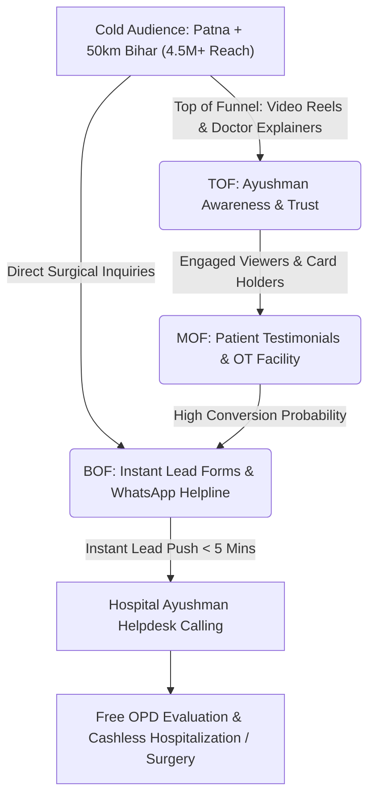
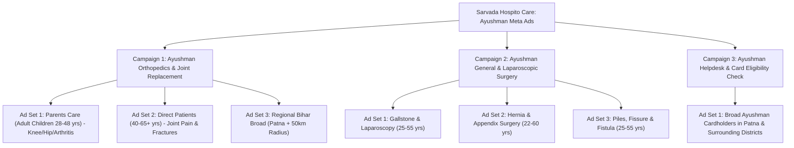

# 🏥 Ayushman Bharat (PM-JAY) Meta Ads Master Plan
## Sarvada Hospito Care — Orthopedics & General Surgery

> **Hospital**: Sarvada Hospito Care (A Unit of Servada Hospito Care Pvt. Ltd.)  
> **Location**: Anand Palace, Bypass Rd, Changer, Kankarbagh, Patna, Bihar 800020  
> **Ayushman Empanelled Specialties**: **Orthopedic Surgery (हड्डी एवं जोड़ रोग)** & **General / Laparoscopic Surgery (सामान्य एवं दूरबीन सर्जरी)**  
> **Coverage**: 100% Free / Cashless Treatment up to **₹5,00,000 per family/year** under PM-JAY  
> **Helpline**: 7079001600 | 7079001700  

---

## 🎯 Executive Strategy & Campaign Funnel

In Bihar, millions of families hold **Ayushman Bharat (PM-JAY) Golden Cards** but are either unaware that private multi-specialty hospitals in Patna accept them for major surgeries, or fear hidden charges. 

This Meta Ads campaign is strategically engineered to establish **trust, transparency, and immediate lead capture** for high-volume, 100% cashless surgeries in **Orthopedics** and **General Surgery**.

---

## 🏗️ Campaign Architecture

We structure the ad account into **3 Dedicated Campaigns**:

---

## 💰 Recommended Budget Allocation

| Tier | Monthly Budget | Daily Spend | Campaign 1 (Ortho) | Campaign 2 (Gen Surgery) | Campaign 3 (Helpdesk) | Expected Leads / Mo |
| :--- | :--- | :--- | :--- | :--- | :--- | :--- |
| **Starter** | **₹30,000** | ~₹1,000 / day | 45% (₹450/d) | 40% (₹400/d) | 15% (₹150/d) | **200 – 350 Leads** |
| **Growth** | **₹60,000** | ~₹2,000 / day | 45% (₹900/d) | 40% (₹800/d) | 15% (₹300/d) | **450 – 750 Leads** |
| **Scale** | **₹1,00,000** | ~₹3,300 / day | 45% (₹1,500/d) | 40% (₹1,300/d) | 15% (₹500/d) | **900 – 1,500+ Leads** |

*Target Cost Per Lead (CPL): ₹70 – ₹130 (Ayushman campaigns achieve low CPL due to high state-wide resonance).*

---

## 📂 Detailed Campaigns, Creatives & Copywriting

---

### 🦴 CAMPAIGN 1: Ayushman Orthopedics & Joint Replacement

* **Objective**: Lead Generation (Instant Forms / Direct Calls).
* **Target Surgeries**: Total Knee Replacement (TKR), Total Hip Replacement (THR), Fracture Fixation, Trauma Surgery, Arthroscopic ACL/Meniscus Repair, Spinal Disc Decompression.
* **Targeting Demographics**:
  * **Ad Set 1 (Family Decision Makers)**: Age 28–48 | Men & Women | Patna + 50 km (Patna, Hajipur, Danapur, Bihta, Fatuha, Vaishali, Chapra, Arrah).
  * **Ad Set 2 (Elderly Patients)**: Age 45–65+ | Interests: Arthritis, Knee pain, Osteoarthritis, Joint replacement.
* **Offer Hook**: **100% Free Total Knee / Hip Replacement under Ayushman Bharat Card (up to ₹5,00,000)**.

#### Creative Concepts:
1. **Static Graphic / Banner**:
   * *Visual*: Smiling elderly couple walking comfortably with Doctor + Golden Ayushman Card badge.
   * *Bold Overlay Text*: *"माता-पिता के घुटने का मुफ़्त ऑपरेशन (Total Knee Replacement) — आयुष्मान भारत कार्ड द्वारा (₹5 लाख तक मुफ़्त)"*.
2. **Video / Reel (Doctor Explainer)**:
   * *Script*: Orthopedic surgeon explaining how modern knee replacement is done at Sarvada Hospito Care with zero out-of-pocket expenses for Ayushman cardholders, including imported implants and physiotherapy.

#### High-Converting Ad Copies:

##### Variation 1: Focus on Parents' Knee Pain (Hindi / Hinglish - Highest Converting)
* **Primary Text**:
  क्या आपके माता-पिता घुटनों के असहनीय दर्द (Arthritis) से परेशान हैं और चलने-फिरने में असमर्थ हो चुके हैं? खर्च की चिंता के कारण ऑपरेशन टाल रहे हैं?
  
  अब ऑपरेशन के खर्च की चिंता छोड़िए! **Sarvada Hospito Care (कंकड़बाग बाईपास, पटना)** में करवाएं विश्वस्तरीय **Total Knee & Hip Replacement (जोड़ प्रत्यारोपण)** एवं हड्डी रोग का 100% मुफ़्त इलाज।
  
  💳 **आयुष्मान भारत कार्ड (PM-JAY) द्वारा ₹5,00,000 तक पूरी तरह मुफ़्त ऑपरेशन**
  👵 **जर्मन तकनीक के प्रीमियम इम्प्लांट्स का उपयोग**
  👴 **वरिष्ठ ऑर्थोपेडिक व स्पाइन सर्जन्स द्वारा ऑपरेशन**
  👵 **ऑपरेशन के तुरंत बाद से ही फिजियोथेरेपी व विशेष देखभाल**
  👴 **दवाइयां, बेड, ऑपरेशन व जांच सब कुछ आयुष्मान कार्ड में शामिल**
  
  माता-पिता को दर्द-मुक्त जीवन का उपहार दें। आज ही आयुष्मान कार्ड की पात्रता जांचने एवं परामर्श के लिए फॉर्म भरें।
* **Headline**: 🦴 आयुष्मान भारत कार्ड से घुटने का मुफ़्त ऑपरेशन (₹5 लाख तक)
* **Description**: सर्वदा हॉस्पिटल, कंकड़बाग बाईपास, पटना | Call: 7079001600
* **CTA Button**: Apply Now (अभी आवेदन करें)

##### Variation 2: Bone Fractures & Trauma Emergency (Hindi / Hinglish)
* **Primary Text**:
  हड्डी टूटने (Fracture) या गंभीर चोट लगने पर तुरंत चाहिए अनुभवी हड्डी रोग विशेषज्ञ की देखरेख।
  
  **Sarvada Hospito Care (पटना)** में 24 घंटे उपलब्ध है इमरजेंसी ट्रॉमा एवं ऑर्थोपेडिक सर्जरी — **आयुष्मान भारत कार्ड द्वारा 100% कैशलेस**।
  
  🔹 सभी प्रकार के फ्रैक्चर व प्लेटिंग सर्जरी  
  🔹 दूरबीन द्वारा लिगामेंट (ACL / Meniscus) रिपेयर  
  🔹 रीढ़ की हड्डी (Spine) का आधुनिक ऑपरेशन  
  🔹 आयुष्मान कार्ड से ₹5 लाख तक का संपूर्ण इलाज मुफ़्त  
  
  नीचे दिए गए बटन पर क्लिक करके अपने आयुष्मान कार्ड की जानकारी सबमिट करें।
* **Headline**: 🏥 हड्डी एवं फ्रैक्चर का मुफ़्त ऑपरेशन | आयुष्मान कार्ड मान्य
* **Description**: 24/7 इमरजेंसी ट्रॉमा एवं ऑर्थोपेडिक केयर, पटना
* **CTA Button**: Book Now

##### Variation 3: Clinical Trust (English)
* **Primary Text**:
  Regain mobility and live pain-free. Sarvada Hospito Care, Patna offers Advanced Joint Replacement (TKR/THR) & Orthopedic Surgeries.
  
  ✅ **100% Cashless Treatment under Ayushman Bharat (PM-JAY) up to ₹5 Lakhs**  
  ✅ Modern Modular OT & Premium Prosthetic Implants  
  ✅ Post-operative Physiotherapy & Fast Recovery Protocol  
  
  Book a consultation today to check your Ayushman eligibility.
* **Headline**: Cashless Knee & Hip Replacement in Patna | PM-JAY Empanelled
* **Description**: Free Treatment up to ₹5,00,000 for Eligible Families
* **CTA Button**: Learn More

---

### 🔬 CAMPAIGN 2: Ayushman General & Laparoscopic Surgery

* **Objective**: Lead Generation (Instant Forms / Direct Calls / WhatsApp).
* **Target Surgeries**: Laparoscopic Gallbladder Removal (Cholecystectomy), Hernia Repair (Open/Lap), Laparoscopic Appendectomy, Laser & Stapler Piles/Fissure/Fistula Surgery, Exploratory Surgery.
* **Targeting Demographics**:
  * Age 22–60 | Men & Women | Patna + 40 km radius.
  * Interests: Abdominal pain, Gallstone, Hernia, Laparoscopic surgery, Gastrointestinal health, Hemorrhoids.
* **Offer Hook**: **100% Free Keyhole / Laparoscopic Surgery under Ayushman Bharat (PM-JAY) with 24-hr discharge**.

#### Creative Concepts:
1. **Split-Screen Infographic**:
   * *Left*: "पित्त की थैली में पथरी / हर्निया का दर्द"
   * *Right*: "दूरबीन द्वारा ऑपरेशन (छोटा चीरा, 24 घंटे में छुट्टी) + आयुष्मान भारत ₹5 लाख मुफ़्त इलाज"
2. **Reel / Video Testimonial**:
   * Video of a patient from Bihar sharing their experience of undergoing successful gallbladder stone / hernia surgery at Sarvada Hospito Care without paying a single rupee under the Ayushman card.

#### High-Converting Ad Copies:

##### Variation 1: Gallbladder Stone Focus (Hinglish/Hindi - High Volume)
* **Primary Text**:
  क्या आपको पेट के ऊपरी हिस्से में तेज दर्द, गैस या उल्टी की शिकायत है? यह पित्त की थैली में पथरी (Gallbladder Stone) के लक्षण हो सकते हैं।
  
  पित्त की पथरी का एकमात्र सुरक्षित और स्थायी इलाज है सर्जरी। **Sarvada Hospito Care (कंकड़बाग, पटना)** में करवाएं आधुनिक **दूरबीन विधि (Laparoscopic Surgery)** द्वारा ऑपरेशन।
  
  💳 **आयुष्मान भारत कार्ड (PM-JAY) द्वारा 100% मुफ़्त ऑपरेशन (₹5 लाख तक)**
  ✅ **दूरबीन द्वारा छोटा चीरा (Keyhole Surgery) — कोई बड़ा निशान नहीं**
  ✅ **न्यूनतम दर्द और मात्र 24 से 48 घंटे में अस्पताल से छुट्टी**
  ✅ **वरिष्ठ लैप्रोस्कोपिक एवं जनरल सर्जन्स द्वारा ऑपरेशन**
  ✅ **दवाइयां, जांच, बेड चार्ज सब कुछ आयुष्मान में शामिल**
  
  देर न करें, इन्फेक्शन बढ़ने से पहले इलाज कराएं। आज ही अपना नाम और नंबर दर्ज करें।
* **Headline**: 🔬 पित्त की पथरी का दूरबीन ऑपरेशन | आयुष्मान कार्ड से मुफ़्त इलाज
* **Description**: ₹5 लाख तक कैशलेस सर्जरी | कंकड़बाग बाईपास, पटना
* **CTA Button**: Book Now (अभी बुक करें)

##### Variation 2: Hernia & Appendix Focus (Hinglish/Hindi)
* **Primary Text**:
  हर्निया (Hernia) या अपेंडिक्स (Appendix) के दर्द को नजरअंदाज न करें। समय पर ऑपरेशन न कराने से यह गंभीर रूप ले सकता है।
  
  **Sarvada Hospito Care (पटना)** में उपलब्ध है आधुनिक दूरबीन एवं जनरल सर्जरी की सुविधा — **आयुष्मान भारत कार्ड धारकों के लिए बिल्कुल मुफ़्त**।
  
  🌟 **100% कैशलेस इलाज (₹5,00,000 तक)**  
  🔹 एडवांस मेश रिपेयर तकनीक (No Recurrence)  
  🔹 संक्रमण-मुक्त मॉड्यूलर ऑपरेशन थिएटर  
  🔹 अनुभवी जनरल सर्जन्स की टीम  
  
  हॉस्पिटल आने से पहले अपने आयुष्मान कार्ड की जांच करवाएं। नीचे फॉर्म भरें।
* **Headline**: 🏥 हर्निया एवं अपेंडिक्स का सफल ऑपरेशन | आयुष्मान भारत कार्ड मान्य
* **Description**: पटना में मुफ़्त सर्जरी सुविधा | Sarvada Hospito Care
* **CTA Button**: Apply Now

##### Variation 3: Piles, Fissure & Fistula (Hindi / Hinglish)
* **Primary Text**:
  बवासीर (Piles), भगंदर (Fistula) या फिशर का दर्द आपकी जिंदगी को मुश्किल बना रहा है? 
  
  **Sarvada Hospito Care (कंकड़बाग बाईपास, पटना)** के जनरल सर्जरी विभाग में पाइए दर्द-रहित आधुनिक इलाज।
  
  💳 **आयुष्मान भारत कार्ड (PM-JAY) द्वारा सर्जरी की सुविधा उपलब्ध**  
  ✅ बिना किसी झिझक के गोपनीय परामर्श  
  ✅ अनुभवी जनरल सर्जन्स द्वारा सुरक्षित उपचार  
  ✅ उसी दिन या 24 घंटे में डिस्चार्ज  
  
  गोपनीय परामर्श के लिए आज ही संपर्क करें।
* **Headline**: 🏥 बवासीर, फिशर और भगंदर का सुरक्षित इलाज | आयुष्मान कार्ड मान्य
* **Description**: गोपनीय परामर्श एवं कैशलेस सुविधा | कॉल करें: 7079001600
* **CTA Button**: Get Offer

---

### 💳 CAMPAIGN 3: Ayushman Helpdesk & Card Eligibility Check

* **Objective**: High-Volume Lead Generation / WhatsApp Chat Flow.
* **Target Audience**: All Adults 22–65+ in Patna, Vaishali, Saran, Nalanda, Bhojpur.
* **Offer Hook**: **"Check if your Ayushman Card is active for Free Surgery at Sarvada Hospito Care"**.

#### Ad Copy:
* **Primary Text**:
  क्या आपके पास **आयुष्मान भारत कार्ड (PM-JAY)** या राशन कार्ड है?
  
  अगर आपको या आपके परिवार में किसी को **हड्डी रोग (घुटने/कूल्हे का दर्द, फ्रैक्चर)** या **जनरल सर्जरी (पित्त की पथरी, हर्निया, अपेंडिक्स, बवासीर)** की समस्या है, तो आप **Sarvada Hospito Care (कंकड़बाग, पटना)** में ₹5,00,000 तक का मुफ़्त इलाज करवा सकते हैं!
  
  🔍 **घर बैठे अपने आयुष्मान कार्ड की पात्रता जांचें:**
  1. नीचे दिए गए फॉर्म में अपना नाम, मोबाइल नंबर और जिला भरें।
  2. हमारा आयुष्मान हेल्पडेस्क 10 मिनट में आपको कॉल करके कार्ड की स्थिति और मुफ़्त इलाज की पूरी जानकारी देगा।
  
  📍 आनंद पैलेस, बाईपास रोड, कंकड़बाग, पटना  
  📞 आयुष्मान हेल्पडेस्क: 7079001600 / 7079001700  
* **Headline**: 💳 आयुष्मान कार्ड से मुफ़्त ऑपरेशन की पात्रता जांचें (₹5 लाख तक)
* **Description**: हड्डी रोग एवं जनरल सर्जरी हेतु सरकार द्वारा अधिकृत अस्पताल
* **CTA Button**: Check Eligibility / Send WhatsApp Message

---

## ⚙️ Geo-Targeting & Location Settings

To maximize surgical admissions from across Bihar:

1. **Core Patna Metro (High Conversion)**:
   * 15 km radius around `Anand Palace, Bypass Rd, Kankarbagh, Patna 800020`.
   * Key areas: Kankarbagh, Bypass, Anisabad, Bailey Road, Danapur, Phulwari Sharif, Rajendra Nagar, Patna City.
2. **Regional Bihar Surgical Radius (High Volume Ayushman Inflow)**:
   * 50 km radius covering:
     * **Vaishali / Hajipur / Lalganj** (Directly connected via Gandhi Setu)
     * **Saran / Chapra / Sonpur**
     * **Bhojpur / Arrah / Bihta**
     * **Nalanda / Bihar Sharif / Fatuha / Bakhtiyarpur**
3. **Location Parameter**: Select **"People living in this location"** in Meta Ads Manager.

---

## 📋 Lead Form Architecture (Quality Filter)

Use Meta **Higher Intent** Instant Forms to prevent accidental clicks:

* **Header Title**: *"Sarvada Hospito Care — आयुष्मान भारत मुफ़्त सर्जरी हेल्पडेस्क"*
* **Form Questions**:
  1. **Full Name** (Auto-filled)
  2. **Phone Number / WhatsApp** (Auto-filled)
  3. **Patient's District / Area** (e.g. Patna, Hajipur, Arrah, Chapra, Nalanda)
  4. **Which surgery / treatment is needed?** *(Required Dropdown)*:
     * 🦴 घुटने / कूल्हे का प्रत्यारोपण (Knee / Hip Replacement)
     * 🦴 हड्डी फ्रैक्चर व जोड़ दर्द (Fractures / Joint Trauma)
     * 🔬 पित्त की थैली में पथरी (Gallbladder Stone)
     * 🔬 हर्निया / अपेंडिक्स (Hernia / Appendix)
     * ✂️ बवासीर / भगंदर / फिशर (Piles / Fistula)
     * ❓ अन्य समस्या (Other)
  5. **Do you have an active Ayushman Bharat Card (PM-JAY)?** *(Required Dropdown)*:
     * ✅ हाँ, आयुष्मान कार्ड उपलब्ध है (Yes - Ayushman Card Holder)
     * 🪪 राशन कार्ड है / चेक करवाना है (Ration Card Holder)
     * ❌ नहीं, प्राइवेट इंश्योरेंस / सेल्फ पे (No Ayushman)

---

## ⚡ 5-Minute Lead Nurturing SOP (Front-Desk / Helpdesk)

Ayushman leads convert into actual OPD visits when contacted **within 5–15 minutes**.

### Step 1: Immediate Phone Call Script
> *"नमस्ते [मरीज/अभिभावक का नाम] जी, मैं सर्वदा हॉस्पिटल केयर (कंकड़बाग बाईपास, पटना) के **आयुष्मान भारत हेल्पडेस्क** से बात कर रहा/रही हूँ। आपने हमारे यहाँ आयुष्मान कार्ड से [हड्डी रोग / पित्त की पथरी / हर्निया] के मुफ़्त इलाज के लिए फॉर्म भरा था।  
> क्या आपके पास मरीज का आयुष्मान कार्ड या राशन कार्ड उपलब्ध है? हम आपके डॉक्टर परामर्श का स्लॉट बुक कर रहे हैं, आप किस दिन हॉस्पिटल आ रहे हैं?"*

### Step 2: Automated WhatsApp Confirmation
Immediately send a WhatsApp message containing:
* Hospital Location Map Link (Bypass Rd, Kankarbagh)
* Required Documents List: (1) Ayushman Card / E-Card (2) Aadhaar Card (3) Previous Doctor Prescriptions / Ultrasound / X-Rays
* Direct Ayushman Coordinator Contact: 7079001600

---

## 🛡️ Meta Advertising Policy Compliance Guardrails

* ✅ **Do**: Use phrases like *"Empanelled Hospital under Ayushman Bharat (PM-JAY)"*, *"Cashless treatment up to ₹5 Lakhs for eligible beneficiaries as per government guidelines"*.
* ❌ **Don't**: Do not guarantee 100% cure; always state that admission is subject to card eligibility and clinical evaluation.
* ❌ **Don't**: Never display graphic open wounds, surgical incisions, or blood in ad creatives. Always use hospital infrastructure, doctor photos, clean medical vector graphics, and happy recovered patients.
